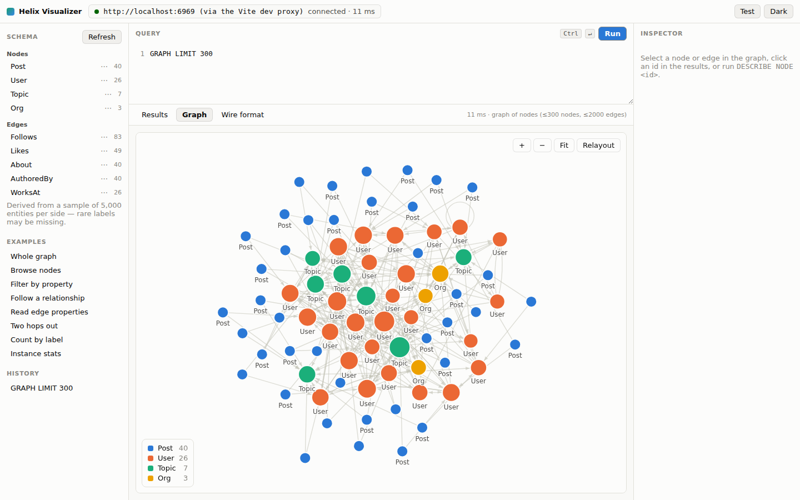

# Helix Atlas

A Tauri desktop app for exploring a [HelixDB](https://github.com/HelixDB/helix-db)
instance: type SQL-like queries to pull back nodes, edges and their
relationships, and draw the graph structure as a whole.

See [the code organization guide](docs/code-organization.md) for module owners and
refactoring boundaries. See [PORTING_GUIDE.md](PORTING_GUIDE.md) for the complete Explorer-style UI,
connection, versioned read APIs, and automatic graph-loading change log.



## What it does

- **Welcome splash** — an Explorer-style startup animation previews a valid,
  read-only HelixSQL graph query before entering the workspace.
- **HelixSQL** — a small SQL-like dialect (`SELECT … FROM NODES … WHERE …
  TRAVERSE OUT …`) that compiles to HelixDB's JSON traversal AST. Full grammar
  below. Atomic node/edge inserts require the pinned server extension described
  in [the mutation guide](docs/mutations.md).
- **Graph view** — connecting from the Graph workspace automatically loads a
  bounded snapshot; a manual `QUERY` statement can replace it. The force-directed
  canvas supports pan, zoom, drag, neighbourhood focus on hover, and per-label
  colouring.
- **Inspector** — click a node or edge to see its properties, its incident edges
  with direction, its neighbours and its degree.
- **Schema sidebar** — node and edge labels discovered from the instance, each
  one a click away from a query.
- **Wire format tab** — the compiled read/write JSON, selected protocol, and actual
  execution endpoint, so nothing about the translation is hidden.
- **Shared UI system** — local shadcn-style components backed by Radix
  primitives provide consistent buttons, fields, tabs, tables, checkboxes,
  dialogs and accessible keyboard behaviour.
- **Typography** — Inter is bundled for the application interface; the
  HelixSQL query editor and other code/wire-format surfaces remain monospaced.

Connection probes, previews, schema discovery, and automatic graph loading remain
read-only. Explicit `INSERT` and `BEGIN MUTATION` execution supports typed parameters
and `RETURNING` on the verified **atlas-mutation-v1** server extension. Ordinary
v2 and legacy v1 servers remain read-only in Atlas. See [mutation setup and
verification](contracts/helixdb-v2/mutations.md).

## Requirements

- Node.js 22.13+ (required by the DOM test runtime and exact JSON integer parsing)
- Rust 1.77+
- A running HelixDB instance (`helix start dev` listens on `localhost:6969`),
  or the bundled mock server below.
- Linux only: the usual Tauri v2 system dependencies —
  `libwebkit2gtk-4.1-dev`, `libsoup-3.0-dev`, `libjavascriptcoregtk-4.1-dev`,
  `librsvg2-dev`, `build-essential`, `libssl-dev`, `pkg-config`.

## Running it

```bash
npm install
npm run app          # tauri dev — builds the Rust backend and opens the window
```

Set the instance from Connection in the top toolbar. It is saved to the app
config directory and prefilled on the next launch. For a Docker mapping such as
`6969:8080`, enter the host-side port `6969`.

The desktop app can connect directly to all of these:

- a local instance such as `http://127.0.0.1:6969`;
- a HelixDB server elsewhere on your network such as `http://192.168.1.20:6969`;
- an HTTPS cloud deployment such as `https://helix.example.com`;
- a deployment behind a gateway path such as `https://example.com/helix`.

Choose **Remote / Cloud** for a full URL. API keys are optional and are sent as
`Authorization: Bearer <key>` only when supplied. Remote URLs default to HTTPS
when the scheme is omitted. The desktop Rust transport is not subject to browser
CORS rules. A saved key is reused only while reconnecting to the same effective
endpoint, so changing the host or gateway path cannot forward an old credential.

Choose **v2** for the pinned operation-tree API. Existing saved connections
without a protocol migrate to **legacy v1**; new settings default to v2. The app
never retries a request against another protocol. Origins and gateway prefixes
receive the selected `/v1/query` or `/v2/query` path. Complete endpoint URLs must
match the selected protocol, including when they have a trailing slash.

Deployment scope is explicit: **Local / direct server**, **Database-specific
Cloud**, or **Shared Cloud gateway**. Shared Cloud v2 sends the entered database
ID as `X-Helix-Database-Id`; other scopes omit that header. An omitted key is
retained only for the same endpoint, database ID, and deployment scope. Cloud
header behavior follows the pinned documentation and has not been tested against
a live Cloud gateway. **Require writer** requires execution on a writer; it does
not route or retry. Reads send neither durability nor cache-warming headers.
A successful connection probe verifies one count read, not all capabilities.

To build a distributable:

```bash
npm run app:build
```

The repo ships PNG icons only. For `.ico`/`.icns` (Windows and macOS bundles),
run `npm run tauri icon src-tauri/icons/icon.png` once.

### Local HelixDB in Docker

The included `compose.yaml` builds HelixDB `v3.5.1` with the
[atlas-mutation-v1 patch](contracts/helixdb-v2/mutations.md), so Atlas can run
mutations against it, and runs it with persistent disk storage. The image is
built from [docker/helixdb-atlas](docker/helixdb-atlas/Dockerfile): it fetches the
pinned upstream commit, verifies the patch checksum, runs the patch's database
tests, and builds the server. The first build takes several minutes.

```bash
docker compose build          # build the patched server image (first time)
docker compose up -d          # start the local database
docker compose logs -f       # follow database logs
docker compose stop          # stop it; keep the container and data
docker compose down          # remove the container; keep the data volume
```

Run these commands from `helix-atlas/` with Docker Desktop running. The container
is `helix-atlas-db`, and its data is stored in the named volume
`helix-atlas-data-v3`. The port is bound only to localhost. The server starts empty;
the app's read-only queries do not insert example data. The earlier `v0.0.6`
setup used the separate `helix-atlas-data` volume, which is left untouched.

In the app's Connection dialog, choose **Local**, host `127.0.0.1`, port `6969`,
protocol **v2**, and deployment **Local / remote server**. Leave the API key blank.
The resolved read endpoint is `http://127.0.0.1:6969/v2/query`.

Readiness can be checked with `curl http://127.0.0.1:6969/readyz`. Avoid
`docker compose down -v` unless you intend to delete the persistent database.

### Without a HelixDB instance

`tools/mock-helix-server.mjs` exercises explicit legacy `/v1/query` and pinned
operation-tree `/v2/query` read formats over a small in-memory sample graph. It
interprets the subset of traversal steps this app emits — it is a development
stand-in, **not** a HelixDB implementation.

```bash
npm run mock                       # listens on :6969
npm run app                        # point the app at http://localhost:6969
```

### Frontend-only development

`npm run dev` can still render the UI shell for styling work, but queries and
connection actions require the Rust process. Use `npm run app` for functional
development. This is intentional: there is one parser, compiler, transport,
and response decoder, all in Rust, instead of a separate browser implementation.

```bash
npm run dev                        # http://localhost:14237
```

## HelixSQL

See the [complete syntax guide and query examples](docs/helixsql.md) for clause
order, filters, traversal directions, aliases, graph queries, and protocol limits.

HelixDB has no SQL dialect of its own; queries are built as a JSON traversal
AST. HelixSQL is a thin, Rust-implemented language over that AST. The backend
lexes, parses, validates, and compiles source using the selected legacy flat
`/v1/query` or nested operation-tree `/v2/query` adapter. The supported v2 server
revision and captured evidence are recorded in
[the contract directory](contracts/helixdb-v2/README.md).

Keywords are case-insensitive; labels and property names are not.

### SELECT

```
SELECT [DISTINCT] ( * | COUNT(*) | <column> [AS <alias>] [, …] )
FROM ( NODES | EDGES ) [ :<Label> ]
[ WHERE <condition> ]
[ TRAVERSE <direction> [<EdgeLabel>] [WHERE <condition>] ]…
[ GROUP BY <column> ]
[ ORDER BY <column> [ASC|DESC] [, …] ]
[ SKIP <n> ] [ LIMIT <n> ]
```

Without a `LIMIT`, 500 rows are fetched.

```sql
SELECT * FROM NODES:User LIMIT 25
SELECT id, name, age FROM NODES:User WHERE age BETWEEN 25 AND 40 ORDER BY age DESC
SELECT COUNT(*) FROM NODES GROUP BY label
SELECT id, label, source, target FROM EDGES:Follows LIMIT 50
```

**Virtual columns.** `id` and `label` work on both nodes and edges; `source` and
`target` are an edge's endpoints. `score` and `distance` are available where
HelixDB populates them. A reserved field can also be written out in full
(`$id`, `$label`, `$from.$id`, `$to.$id`). To read a *property* actually named
`id`, quote it: `SELECT id, "id" AS stored_id FROM NODES`. Duplicate output
names require distinct aliases. Entity IDs are decimal strings in tables and IPC.

`WHERE label = 'User'` and `FROM NODES:User` compile to the same thing — a label
match on the source step, so HelixDB can use its label index.

**Conditions.** `= != <> > >= < <=`, `AND`, `OR`, `NOT`, parentheses, `IN (…)`,
`BETWEEN … AND …`, `IS [NOT] NULL`, `HAS(<property>)`, and `LIKE` with `%` at
either end (`'ali%'`, `'%son'`, `'%li%'`). `_` is not supported.

**Traversal directions.**

| Direction | Starts from | Lands on |
|---|---|---|
| `OUT` / `IN` / `BOTH` | node | neighbouring nodes |
| `OUT EDGES` / `IN EDGES` / `BOTH EDGES` | node | the edges themselves |
| `SOURCE` / `TARGET` / `OTHER` | edge | the edge's endpoints |

```sql
-- who does Alice follow, and who do they follow?
SELECT DISTINCT id, name
FROM NODES:User WHERE name = 'Alice'
TRAVERSE OUT Follows
TRAVERSE OUT Follows

-- read a property stored on the relationship itself
SELECT label, source, target, since
FROM NODES:User
TRAVERSE OUT EDGES Follows WHERE since > 2022
```

Using a hop from the wrong side (`FROM EDGES … TRAVERSE OUT`) is rejected before
anything is sent, with the offending clause pointed at.

### QUERY

Returns nodes plus the edges among them, and draws them.

```
QUERY [ [FROM] NODES[:<Label>] ]
[ WHERE <condition> ] [ TRAVERSE … ]…
[ VIA <EdgeLabel> ] [ WITH <property> [, …] ]
[ ORDER BY … ] [ SKIP <n> ] [ LIMIT <n> ] [ EDGE LIMIT <n> ]
```

`LIMIT` caps nodes (default 400), `EDGE LIMIT` caps edges (default 2000), `VIA`
restricts which edge label is drawn, and `WITH` fetches node properties so the
canvas can label nodes by name rather than by type.

Edges are fetched from the selected nodes (incident edges in v2, outgoing edges
in legacy v1), so
they belong to the part of the graph on screen. On a graph larger than `LIMIT`
some of them will still lead to nodes that were not fetched; those cannot be
drawn, and the view reports how many rather than dropping them silently.

```sql
QUERY LIMIT 300
QUERY NODES:User VIA Follows WITH name LIMIT 150
QUERY NODES WHERE id = 42 TRAVERSE BOTH LIMIT 200
```

`GRAPH` is still accepted as a compatibility alias for saved queries, but new
queries and app-generated examples use `QUERY`.

Only edges whose *both* endpoints are in the fetched node set can be drawn. Any
that leave the selection are counted and reported under the canvas rather than
silently dropped.

### SHOW and DESCRIBE

```sql
SHOW LABELS [SAMPLE <n>]     -- also: SHOW NODE LABELS, SHOW EDGE LABELS
SHOW STATS                   -- node/edge totals plus label breakdowns
DESCRIBE NODE <id> [LIMIT <n>]
DESCRIBE EDGE <id>
```

HelixDB has no catalog to query, so labels are derived by counting `$label` over
a bounded sample (5000 entities by default). Rare labels can be missed; the
sample size is stated wherever labels are shown.

### Keyboard and mouse

| | |
|---|---|
| `Ctrl`/`Cmd` + `Enter` | run the query |
| double-click a node | load its neighbourhood into the editor |
| drag a node | move it to a clearer position |
| scroll | zoom about the cursor |

## How it fits together

```
src/App.tsx              application shell and workspace composition
src/app/                 connection session, query compilation, theme, workspace views
src/ui/                  editor, results, inspector, sidebar, schema, connection UI
src/ui/connection/       connection dialog, draft form, URL helpers, toolbar icons
src/graph/               force simulation, quadtree, React Flow interaction, palette
src/graph/flow/          element construction and node/edge renderers
src/styles.css           ordered entry point for styles/*.css
src-tauri/src/lib.rs      Tauri startup and command registration
src-tauri/src/commands/   query/connection IPC and schema discovery
src-tauri/src/connection.rs, state.rs, transport.rs, error.rs
                         settings, persistence, HTTP execution, structured errors
src-tauri/src/hql/        lexer, parser stages, plan, validation, legacy/v2 lowerers
src-tauri/src/results/    models, adaptation, rows, counts, graphs, descriptions, JSON
src-tauri/src/schema.rs   pure schema query generation and field inference
tools/mock/              fixtures, JSON helpers, shared helpers, versioned evaluators
```

The webview never parses HQL or talks to HelixDB directly. It hands source text
to the Rust command `run_query`; Rust compiles it, posts it to the selected
version's resolved query endpoint,
and returns a decoded view model. That keeps the app clear of webview CORS rules, lets an `https`-origin webview reach a
plain-HTTP local instance, and keeps the API key in the backend's config file
rather than in webview storage. That file is written to the platform config
directory as `connection.json`, narrowed to `0600` on Unix; the key is stored in
plain text, so it is protected by file permissions rather than by a keychain.

v2 entity IDs are `u64`, including zero. Integer token text stays exact until
validation: property integers use `i64`, entity lookups use `u64`, and legacy IDs
are limited to `i64::MAX`. Rust exposes IDs as decimal strings and converts
integer properties outside JavaScript's safe range to strings before IPC,
including schema samples, while retaining their inferred integer type.

The pinned v2 server clamps virtual-ID expressions above `i64::MAX` and has no
unsigned predicate constant. Exact `DESCRIBE` and standalone initial `WHERE id =`
or `id IN (…)` use unsigned source references. General virtual-ID comparisons
above the signed range, and virtual-ID ordering/grouping, fail locally with a
hint instead of silently returning the wrong entities. Grouping a property
named `count` is also rejected in v2 because it collides with the aggregate key.

## Tests

For a hands-on end-to-end tour, follow the [sample queries and mutations](docs/mutation-walkthrough.md).

```bash
npm test                    # unit, DOM workflow, and loopback HTTP tests
npm run test:coverage       # coverage gates and coverage/index.html
npm run build              # typecheck and production frontend build
cargo test --manifest-path src-tauri/Cargo.toml
```

Rust tests cover both compilers, strict decoding, identity association, exact
numeric boundaries, connection migration, endpoints, headers, structured errors,
and schema inference, plus persistence failures and real loopback HTTP execution.
JavaScript tests cover connection dialogs, application workflows, asynchronous
request races, editor interactions, result tables, inspector links, schema
browsing, graph layout, and compiler fixtures replayed against the strict mock.
See the [test coverage guide](docs/testing.md) for the scenario map, coverage
gates, and remaining gaps. See
[verification evidence](contracts/helixdb-v2/verification.md) for the real v2
server corpus, desktop smoke checks, commands, and remaining coverage limits.

## Known limits

- Mutations require the pinned v2 server extension; legacy v1 remains read-only.
  `UPDATE`, `DELETE`, `UPSERT`, and `INSERT … SELECT` are not supported.
  [Mutation syntax, examples, parameters, and limits](docs/mutations.md).
- `VIA` takes a single edge label, not a list.
- `LIKE` supports `%` only at the start and/or end of the pattern.
- v2 `SELECT *` materializes the selection once and projects exact identity and
  properties from that binding, preserving ordering and duplicates. Legacy v1
  retains separate projections but associates them by verified entity identity;
  missing identity is an error. Neither adapter guesses association by position
  across independently evaluated selections.
- Sorting a results table sorts the rows already fetched; `ORDER BY` in the query
  is what sorts the whole result set.
- The graph view colours up to 8 labels; beyond that the rarest fold into a
  neutral "Other" bucket rather than reusing a hue.
